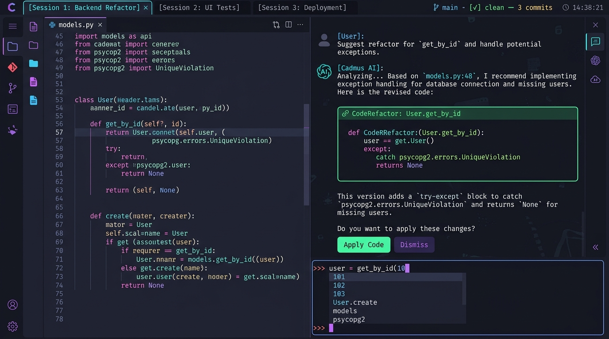
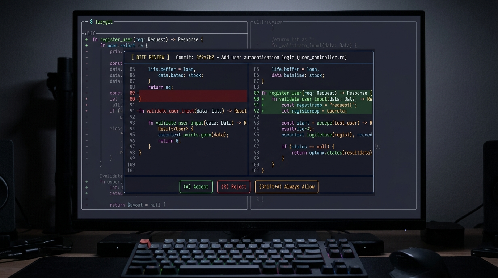
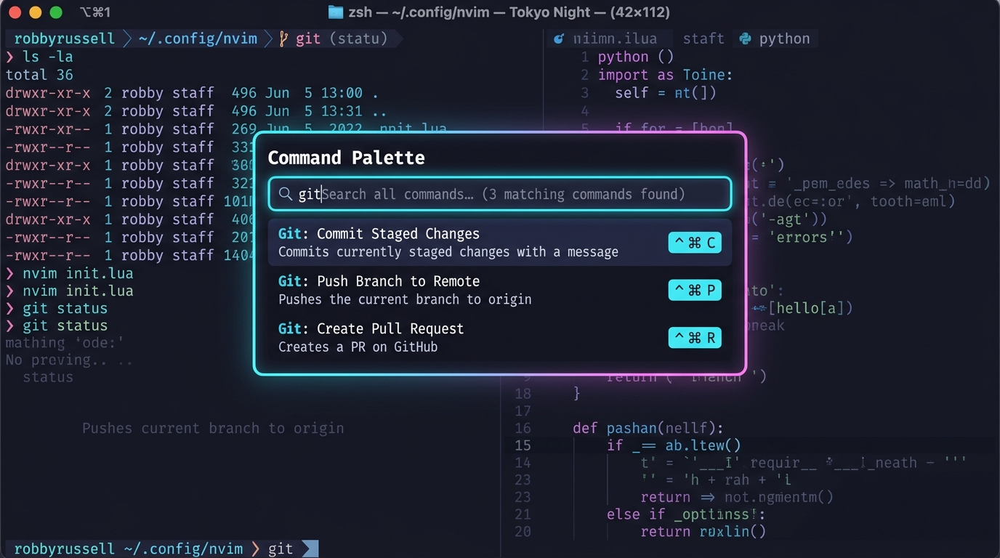

# ⚡ Cadmus (`cadmus-agent`)

<p align="center">
  <strong>Terminal-Native AI Pair Programmer with Bubble Tea Elm Architecture, SQLite Hybrid Search & Autonomous Tools</strong>
</p>

<p align="center">
  
  
  
  
  
  
</p>

---

## 🏛️ About Cadmus

Named after **Cadmus** (Greek: *Κάδμος*), the mythical hero who introduced the Phoenician alphabet and the art of writing to the ancient world and founded the citadel of Thebes. 

**Cadmus** is an open-source, terminal-native AI coding assistant inspired by **OpenCode** and **Cursor**. Built in pure TypeScript with **The Elm Architecture** (`@oakoliver/bubbletea`), Cadmus provides a full-screen, double-buffered terminal IDE experience featuring sticky chrome, scrollable message history, real-time token streaming, and autonomous tool calling.

---

## 📸 Interface Preview

### Full-Screen OpenCode TUI (Tokyo Night Theme)


> **Pinned Top Chrome**: Chrome-style session tabs (`1: Main*`, `2: Refactor`, `+ New`) + persistent header bar with live context token meter (`2.4k / 128k ctx`).  
> **Scrollable Conversation Viewport**: Streams markdown code blocks and collapsible tool execution cards at 60fps with sticky auto-scroll.  
> **Pinned Bottom Command Bar**: `[BUILD MODE]` indicator, leader key shortcuts, and input prompt with live `/` command and `@` attachment autocomplete popover.

---

## ⚡ Interactive Modals & Workflows

| Interactive Diff Review Modal | Global Command Palette (`Ctrl+P`) |
| :---: | :---: |
|  |  |
| *Review colored additions/deletions before applying file changes (`[a] Accept`, `[r] Reject`, `[y] Always Allow`).* | *Instant fuzzy search across all slash commands, model switches, and agent actions.* |

---

## ✨ Key Features

### 1. OpenCode-Grade Bubble Tea TUI
- **The Elm Architecture**: Built with `@oakoliver/bubbletea` using pure `Model-Update-View` event cycles.
- **Alternate Screen Buffer (`altscreen`)**: Full-screen developer environment that cleanly restores your terminal shell when exiting without leaving cluttered scrollback artifacts.
- **Scrollable Conversation Viewport**: Inspect past responses, code blocks, and tool logs using `PageUp`, `PageDown`, or arrow navigation.
- **8 Built-in Color Themes**: Switch instantly across curated themes (`/theme` or `Ctrl+X t`):
  - **Tokyo Night** (Default)
  - **Catppuccin Mocha**
  - **Nord Arctic**
  - **Dracula**
  - **GitHub Dark**
  - **Solarized Dark**
  - **Monokai Pro**
  - **One Dark**

### 2. Dual Modes (`BUILD` vs `PLAN`)
- **`[BUILD MODE]`** (Green): Full agent autonomy—allows file reading, targeted editing, and terminal command execution.
- **`[PLAN MODE]`** (Yellow): Safe, read-only architectural exploration—file modifications and terminal execution are strictly restricted.
- *Toggle instantly by pressing `Tab` when the prompt is empty or typing `/mode`.*

### 3. Embedded SQLite Hybrid Search
- Combines **SQLite FTS5** (BM25 keyword search) and vector embeddings using **Reciprocal Rank Fusion (RRF)**.
- **Incremental Codebase Indexer**: Scans workspace files respecting `.gitignore` and uses SHA-256 hashes to re-index only changed files in milliseconds.

### 4. Cursor-Style `@` Context Attachments & `!` Shell
- `@file <path>#start-end`: Injects specific file contents or line-numbered windows.
- `@folder <dir>`: Injects directory trees and hierarchy.
- `@git`: Injects active branch, status, and working tree diff.
- `@web <url>`: Scrapes external web documentation and converts it to markdown.
- `@search <query>`: Queries the SQLite hybrid index and attaches top code snippets.
- `!<command>`: Executes instant inline shell commands without LLM overhead (e.g. `!git status`).

### 5. Local LLMs & AirLLM Integration
- **Zero-Config Local Probing**: Automatically detects **Ollama** (`:11434`), **LM Studio** (`:1234`), and **AirLLM** (`:8001`).
- **AirLLM Layer-Wise Streaming**: Stream massive 70B+ models (e.g. `Meta-Llama-3-70B`, `Qwen-2.5-Coder-32B`, `DeepSeek-Coder-33B`) on a **single 4GB/8GB consumer GPU** via dynamic layer streaming without CUDA Out-Of-Memory (OOM) crashes.
- **Cloud Providers**: Native support for **OpenRouter** (200+ models with one key), Anthropic Claude, OpenAI, and Google Gemini.

### 6. 7 Core Autonomous Agent Tools
1. `read_file`: Line-windowed file reader.
2. `edit_file`: Targeted search-and-replace with colored diff approval dialog.
3. `list_dir`: Recursive directory explorer.
4. `file_search`: Fast file name and glob pattern finder.
5. `codebase_search`: Conceptual and semantic search across indexed code in SQLite.
6. `grep_search`: Blazing fast regex search powered by bundled native `ripgrep`.
7. `run_terminal_command`: Safe OS-specific shell execution (PowerShell on Windows, Bash/Zsh on Unix) with confirmation controls.
- **Turn Rollback & Undo**: Revert file changes from the most recent turn anytime with `/undo` or `Ctrl+X u`.

---

## ⌨️ Keyboard Shortcuts Reference

### Global Leader Key (`Ctrl+X`)
Press `Ctrl+X` followed by a single key for instant shortcuts:

| Shortcut | Action | Description |
| :--- | :--- | :--- |
| `Ctrl+X n` | `/clear` | Start fresh new conversation session |
| `Ctrl+X l` | `/sessions` | Open session switcher dialog |
| `Ctrl+X m` | `/models` | Open model catalog & local LLM scanner |
| `Ctrl+X c` | `/compact` | Compact conversation history into concise summary |
| `Ctrl+X u` | `/undo` | Roll back file changes from the last turn |
| `Ctrl+X d` | `/details` | Toggle verbose tool execution card view |
| `Ctrl+X t` | `/theme` | Open interactive 8-theme color picker |
| `Ctrl+X q` | `/exit` | Exit Cadmus cleanly |

### Navigation & Editing
| Key | Action |
| :--- | :--- |
| `Ctrl+P` | Open global fuzzy **Command Palette** |
| `Tab` | Toggle between **`BUILD`** and **`PLAN`** modes (when prompt is empty) |
| `Tab` / `Enter` | Complete selected suggestion in autocomplete popup |
| `PageUp` / `Shift+Up` | Scroll conversation viewport upward |
| `PageDown` / `Shift+Down` | Scroll conversation viewport downward |
| `Up` / `Down` | Traverse prompt history (or navigate dropdown suggestions) |
| `Ctrl+C` | Dismiss active modal or exit Cadmus |

---

## 📖 Slash Commands Catalog

Type `/` at the prompt to trigger real-time autocomplete:

| Command | Arguments | Description |
| :--- | :--- | :--- |
| `/mode` | `[plan\|build]` | Toggle between BUILD (read/write) & PLAN (read-only) |
| `/theme` | - | Open interactive 8-theme color selector |
| `/sessions` | - | Switch or manage conversation sessions |
| `/undo` | - | Revert file modifications from the most recent turn |
| `/compact` | - | Compact conversation history to reduce token usage |
| `/details` | - | Toggle expanded verbose tool execution details |
| `/connect` | - | Configure API keys (OpenRouter, Anthropic, OpenAI) |
| `/models` | `[openrouter\|search <q>]` | Browse curated catalog or search Hugging Face |
| `/pull` | `<model>` | 1-click download an Ollama model with live progress |
| `/local` | - | Scan for running local LLMs (Ollama, LM Studio, AirLLM) |
| `/model` | `<name>` | Switch active LLM on the fly |
| `/index` | - | Re-index repository into SQLite for hybrid search |
| `/status` | - | Display OS, shell, ripgrep, and database status |
| `/clear` | - | Reset conversation session history |
| `/help` | - | Print complete help overview |
| `/exit` | - | Exit Cadmus |

---

## 🚀 Getting Started

### 1. Prerequisites
- **Node.js** v20+ (tested through Node.js v26)
- **Git**

### 2. Installation & Setup
Clone the repository and install dependencies:
```bash
git clone https://github.com/your-username/cadmus.git
cd cadmus
npm install
```

Copy the example environment configuration:
```bash
cp .env.example .env
```

Add your preferred API key in `.env`:
```env
# Access 200+ models with one key (DeepSeek R1, Claude 3.7, Qwen 2.5 Coder):
OPENROUTER_API_KEY=your_openrouter_key_here

# Or individual providers:
ANTHROPIC_API_KEY=your_anthropic_key_here
OPENAI_API_KEY=your_openai_key_here
GEMINI_API_KEY=your_gemini_key_here

DEFAULT_MODEL=openrouter/deepseek/deepseek-r1
# or ollama/qwen2.5-coder:7b / claude-3-7-sonnet-latest
```

### 3. Run Cadmus

```bash
# Launch interactive TUI in development mode
npm run dev

# Or build production bundle
npm run build
npm start
```

### 4. Install Globally as CLI (Optional)
```bash
npm link
```
Now you can launch Cadmus anywhere in your terminal:
```bash
# Launch interactive full-screen TUI
cadmus

# Or execute one-shot headless command
cadmus "Explain the authentication flow in src/auth"
```

---

## 🧪 Automated Testing

Cadmus includes a comprehensive test suite of **60 automated tests** covering OS detection, bundled ripgrep resolution, SQLite FTS5 hybrid search, attachment parsing, tool execution, and the complete Bubble Tea Elm Architecture TUI:

```bash
npm test
```

```
✔ Parses and resolves @file and @git attachments
✔ Executes inline ! shell commands directly
✔ Autocomplete: Typing '/' filters slash commands
✔ Autocomplete: Dynamic workspace file completion
✔ BubbleTea OpenCode: createInitialModel sets up dimensions and sessions
✔ BubbleTea OpenCode: TokenChunkMsg appends tokens to assistant history
✔ BubbleTea OpenCode: ToolStartMsg and ToolCompleteMsg track tool cards
✔ BubbleTea OpenCode: DiffApprovalRequestMsg opens modal and handles accept/reject
✔ BubbleTea OpenCode: Ctrl+P opens Command Palette and Ctrl+X opens Leader Key
✔ BubbleTea OpenCode: Tab toggles BUILD vs PLAN mode
✔ Themes: All 8 OpenCode themes registered with complete color palettes
✔ ToolRegistry registers all 7 tools
✔ UndoManager: Snapshots and rolls back modified files
...
ℹ tests 60
ℹ pass 60
ℹ fail 0
```

---

## 📄 License

MIT © 2026 Cadmus Contributors.
